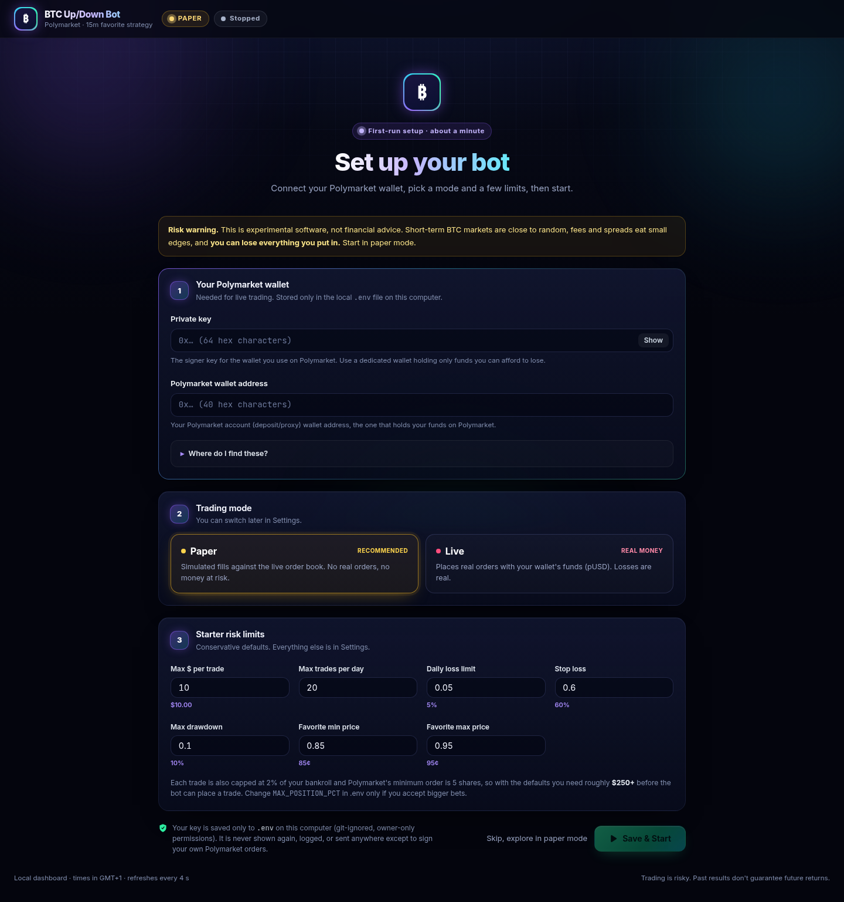
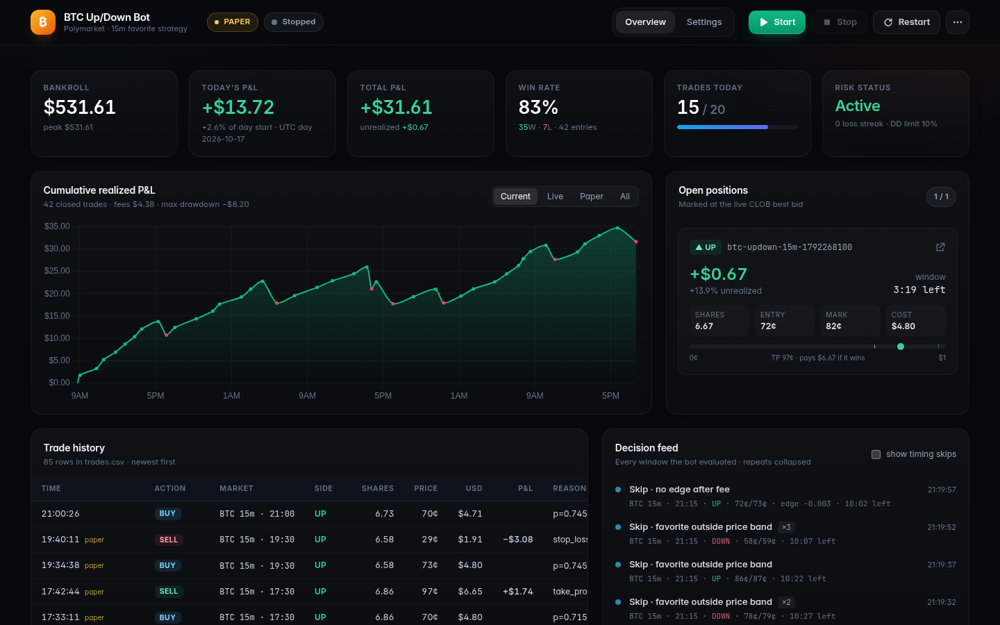

# Polymarket BTC Up/Down bot (5m + 15m) + local dashboard

A continuously running Python bot for Polymarket's **Bitcoin Up or Down** 5-minute and 15-minute
markets, plus a local web dashboard to watch and control it. It runs in **paper mode by default**.

- `bot.py`: the trading engine (market scanner, news check, entry rule, order execution,
  position management, risk controls, main loop).
- `dashboard/`: a local web UI (FastAPI + a no-build single page) showing live status, P&L,
  positions, trades, the decision feed and the log, with start/stop/restart and a settings editor.
- `backtest.py` / `collect_data.py`: download history and replay the bot's own rules against it.

> ## ⚠️ Risk disclaimer
> This is experimental software, not financial advice. **You can lose all the money you put in.**
> Over 5 to 15 minutes, BTC moves are close to random, and news rarely
> moves price predictably on that horizon. These markets are priced by fast, well-informed
> traders. Crypto markets also charge a taker fee (`0.07 × p × (1−p)` per share, up to 1.75¢ at 50¢),
> and you pay the bid/ask spread twice per round trip. A paper test on the live book cost about
> 13% on a 28¢ contract just to get in and out. A 21-day backtest (below) found the original
> model lost about 5% per $ traded. **No script guarantees profit.** Expect this bot
> to skip almost every window, and expect to lose money if you loosen its thresholds.
> Paper-trade for days first. If you then go live, use a small amount you can afford to lose.
> Check that Polymarket is permitted where you live (see [Restrictions](#restrictions)).

## Quick start (dashboard, ~2 minutes)

You need **Python 3.11+** ([python.org](https://www.python.org/downloads/); on Windows tick
*"Add python.exe to PATH"*) and **git**.

1. **Clone**
   ```bash
   git clone https://github.com/SammyCodes1/polymarket-btc-bot.git
   cd polymarket-btc-bot
   ```
2. **Launch the dashboard.** On Windows, double-click **`start_dashboard.bat`**. On macOS/Linux, run
   **`./start_dashboard.sh`**. The first run creates `.venv` and installs the requirements, then
   opens <http://127.0.0.1:8787/>.
3. **Paste your private key and Polymarket wallet address** on the setup screen. See
   [Plugging in a wallet](#plugging-in-a-wallet-live-mode) for where to find them. Use a dedicated
   wallet with only money you can afford to lose.
4. **Choose Paper or Live.** Paper is the default and places no real orders. Live requires typing
   `GO LIVE` and ticking *"I understand this uses real money"*.
5. Set the starter limits and click **Save & Start**. You land on the live overview.

You can also click *"Skip, explore in paper mode"* to try the bot without a wallet.



> 🔐 **Security:** your private key is written **only** to the local `.env` file in this folder
> (owner-only permissions where the OS supports it). `.env` is in `.gitignore`, so it is never committed.
> The dashboard never displays, logs or returns the key after you save it, accepts wallet changes
> only from this computer (127.0.0.1), and doesn't keep a backup copy of it. Anyone who gets the key
> controls the wallet, so don't share `.env` and don't run this on a shared or untrusted computer.

> ⚠️ With the default sizing (`MAX_POSITION_PCT=0.02`) and Polymarket's 5-share minimum order, the bot
> needs roughly a **$250+ bankroll** before it can place a trade. Smaller accounts will just see skips.

## Manual setup (without the launcher)

**Windows (PowerShell or cmd)**
```bat
cd polymarket-btc-bot
py -3.12 -m venv .venv
.venv\Scripts\python.exe -m pip install -r requirements.txt
copy .env.example .env
```

**macOS / Linux**
```bash
cd polymarket-btc-bot
python3 -m venv .venv && source .venv/bin/activate
pip install -r requirements.txt
cp .env.example .env
```

Edit `.env` by hand, or let the dashboard's setup screen fill it in. The defaults are paper mode
with no keys needed. **Never commit `.env`** (it's in `.gitignore`).

## Running the bot

```bash
python bot.py                        # runs forever; Ctrl+C to stop (Windows: .venv\Scripts\python.exe bot.py)
python bot.py --max-loops 20         # short test run
python bot.py --stop-after-trades 1  # exit after N entries once all positions are closed
python bot.py --flatten              # close all open positions and exit
python collect_data.py --days 21 && python backtest.py --tune   # validate on history
```

Ways to stop it:
- **Ctrl+C** (or SIGTERM): finishes the current loop, saves state, exits. Positions stay open.
- **`data/STOP` file**: same graceful stop; the dashboard's Stop button uses this. The bot deletes it.
- **`KILL` file** (in the bot folder or `data/`): emergency halt. The bot **sells all open positions**
  and stops entering. The halt is saved in `state.json` until cleared (dashboard → ⋯ → Clear halt).

Outputs go to `data/`:
- `decisions.csv`: every window evaluated, with the verdict (`ENTER`, `skip:fav_price`, ...), probability, bid/ask, edge
- `trades.csv`: every paper or live fill, exit reason, and P&L
- `state.json`: bankroll, open positions, and daily counters (persists across restarts)
- `bot.log`: the full log

## Dashboard



**Windows:** double-click **`start_dashboard.bat`**. **macOS/Linux:** `./start_dashboard.sh`.
On first run it creates `.venv` and installs `requirements.txt`, then starts the server and opens
<http://127.0.0.1:8787/>. Close the window (or Ctrl+C) to stop the dashboard; the bot keeps running.
If `.env` is missing or has no key or address, the dashboard shows the first-run setup screen.

**Any OS:**
```bash
python dashboard/server.py           # http://127.0.0.1:8787/
python dashboard/server.py --open    # and open the browser
python dashboard/server.py --port 9000
```

What you get (refreshes every 4 s):
- Header: LIVE / PAPER mode, running or stopped (pid, uptime, last log heartbeat), Start / Stop / Restart,
  and a ⋯ menu with Force kill, Emergency halt & flatten, and Clear halt.
- KPI cards: bankroll, today's P&L, total P&L, win rate, trades today vs the daily cap, risk/halt status.
- Open positions marked at the live CLOB best bid (`clob.polymarket.com/book`), with unrealized P&L and a
  countdown. Resolved-but-unsettled positions are marked from Gamma's outcome price.
- Cumulative realized P&L chart and trade history from `trades.csv` (filter Current / Live / Paper / All).
- Decision feed of recent entries and skips with reasons (repeats collapsed; timing skips hidden by default).
- `bot.log` tail with level filters; anything that looks like a key is redacted.
- Settings tab to edit a whitelist of strategy and risk keys in `.env`, then **Save & restart**.

Controls:

| Button | What it does |
|---|---|
| Start | Launches `.venv` Python `bot.py` in the background (detached, so closing the dashboard doesn't stop it). PID in `data/bot.pid`. Refuses if the bot is already running or a `KILL` file exists. Asks for confirmation in LIVE mode. |
| Stop | Graceful: writes `data/STOP` (plus SIGTERM on Linux/macOS). The bot exits after its current loop; **positions stay open**. Force-killed after 45 s if it hasn't exited. |
| Restart | Stop (as above), then Start. |
| Force kill | Kills the process tree immediately. Positions stay open. |
| Emergency halt & flatten | Type `HALT`. Creates the `KILL` file: the running bot sells everything and stops entering. |
| Close (on a position card) | Shows the market, side, shares, current bid and estimated proceeds/P&L, then asks the running bot to sell that one position at market. The dashboard only writes `data/close_requests.json`; on its next loop the bot sells through its normal exit path (same fee and bookkeeping as a stop-loss), logs `CLOSED ... reason=manual_close`, adds a `SELL` row to `trades.csv` and writes the outcome to `data/close_results.json`. Requests expire after 2 minutes (`MANUAL_CLOSE_TTL_SECONDS`). A manual close counts toward the daily loss limit but not toward `MAX_CONSECUTIVE_LOSSES` or the post-loss cooldown, and the bot will not re-enter that window. Needs the bot to be running. API: `POST /api/positions/close` with `{"key"\|"token_id"\|"slug": ...}` or `{"all": true}`. |
| Clear halt | Type `RESUME`. Bot must be stopped. Removes `KILL` and resets the halt flag in `state.json` (a drawdown halt also resets the peak to the current bankroll). |

Safety:
- Binds to **127.0.0.1** only. Binding elsewhere (`--host`) is refused unless `DASHBOARD_TOKEN` is set.
- Set `DASHBOARD_TOKEN` (env or `.env`) to require a token for every control/settings call.
- The private key, wallet address, API keys and `LIVE_TRADING_CONFIRM` are **never** returned or editable.
- Switching to live (on the setup screen or in Settings) needs you to type `GO LIVE` **and** tick
  *"I understand this uses real money"*. Only then does the dashboard write `DRY_RUN=false` and
  `LIVE_TRADING_CONFIRM=I_UNDERSTAND_THIS_USES_REAL_MONEY`. Switching back to paper during setup clears it.
- Settings → **Wallet** shows only the masked address and "key set: yes", with Replace key and Remove key.
- Wallet setup endpoints only accept requests from 127.0.0.1, whatever `--host` is set to.
- Control calls must be same-origin JSON requests, so other websites can't trigger them.
- `.env` is rewritten atomically with owner-only permissions (chmod 600 where supported). No backup copy is kept, so the key exists only in `.env`.

The dashboard detects a bot that was started outside it (e.g. from a terminal) and can stop it too.

## Configuration

All settings are environment variables in `.env` (see `.env.example` for every key). The main ones:

| Key | Default | Dashboard | Meaning |
|---|---|---|---|
| `DRY_RUN` | `true` | ✏️ (typed confirm) | Paper mode. Live needs `DRY_RUN=false` **and** `LIVE_TRADING_CONFIRM`. |
| `LIVE_TRADING_CONFIRM` | — | never shown | Must be `I_UNDERSTAND_THIS_USES_REAL_MONEY` to trade live. |
| `POLYMARKET_PRIVATE_KEY` / `POLYMARKET_WALLET_ADDRESS` | — | never shown | Signer key and account wallet (live only). |
| `STRATEGY` | `favorite` | read-only | `favorite` (v2 rule) or `model` (v1, research only). |
| `FAV_DURATIONS` | `15m` | read-only | Window lengths the favorite rule trades. |
| `FAV_MIN_PRICE` / `FAV_MAX_PRICE` | `0.85` / `0.95` | ✏️ | Favorite's mid must be in this band (ask ≤ max). |
| `FAV_MIN_SECS_LEFT` / `FAV_MAX_SECS_LEFT` | `600` / `900` | ✏️ | Seconds left in the window to allow entry. |
| `FAV_EDGE_EST` | `0.015` | ✏️ | Edge assumed over the mid. Entry needs `mid + edge − ask − fee > 0`. Higher = looser. |
| `MAX_POSITION_USD` | `10` | ✏️ | Hard cap per trade. |
| `FAV_MIN_SIZE_ONLY` / `FAV_MIN_SIZE_BUFFER` | `false` / `0.03` | read-only | Stake only the market minimum (5 shares × ask, +3% buffer), never above `MAX_POSITION_USD`. At 82–92¢ that is ~$4.28–4.74 instead of $4.80: losses ~9% smaller ($4.39 vs $4.80 avg), total profit ~6% smaller (Oct 2026 backtest). |
| `MAX_POSITION_PCT` / `KELLY_FRACTION` | `0.02` / `0.25` | read-only | Per-trade % of bankroll and Kelly fraction caps. |
| `MAX_OPEN_POSITIONS` | `2` | ✏️ | Concurrent positions. |
| `MAX_TRADES_PER_DAY` | `20` | ✏️ | Entries per UTC day. |
| `TAKE_PROFIT_MIN_BID` | `0.97` | ✏️ | Take profit once the bid reaches this. |
| `STOP_LOSS_PCT` | `0.60` | ✏️ | Sell after losing this fraction of cost. |
| `NEWS_GATE` | `false` | read-only | Pre-trade news gate: UP only if news is bullish, DOWN only if bearish, else skip (fails closed). |
| `NEWS_GATE_THRESHOLD` / `NEWS_GATE_MIN_RELEVANT` / `NEWS_GATE_MAX_AGE_SECONDS` | `0.10` / `5` / `300` | read-only | Label threshold, minimum relevant headlines, maximum refresh age. |
| `ENTRY_MODE` / `LIMIT_OFFSET` / `LIMIT_CANCEL_SECS_LEFT` | `market` / `0.01` / `600` | read-only | Taker FOK entry, or a resting post-only limit bid at mid − offset (see "Limit entries"). |
| `FAV_STOP_DROP_CENTS` | `0` (off) | read-only | Hard stop: sell once the bid is this many cents below entry (e.g. `15`). Fires before `STOP_LOSS_PCT` when tighter. |
| `FAV_EXIT_SECONDS_LEFT` | `0` (off) | read-only | Time exit: sell any position not at take-profit with this many seconds left, and never enter with less time left. |
| `DAILY_LOSS_LIMIT_PCT` | `0.05` | ✏️ | Halt for the UTC day after this loss. |
| `MAX_DRAWDOWN_PCT` | `0.10` | ✏️ | Halt when bankroll falls this far below its peak (not auto-reset). |
| `MAX_CONSECUTIVE_LOSSES` / `COOLDOWN_AFTER_LOSS_SECONDS` | `4` / `600` | read-only | Loss-streak halt and pause after a loss. |
| `ARB_ENABLED` | `true` | read-only | Complete-set arbitrage when Up+Down asks + fees < $1. |
| `KILL_SWITCH_FILE` | `KILL` | read-only | File name that triggers halt & flatten. |
| `LOOP_SECONDS` / `SCAN_SECONDS` | `5` / `20` | read-only | Main loop and market rescan intervals. |
| `DATA_DIR` | `./data` | — | Where the bot (and dashboard) read/write files. |
| `DASHBOARD_TOKEN` / `DASHBOARD_PORT` | — / `8787` | — | Dashboard access token and port. |

## Limit entries (`ENTRY_MODE=limit`)

The default `ENTRY_MODE=market` buys the favorite with a fill-or-kill order at the ask and pays the taker fee.
`ENTRY_MODE=limit` instead rests a **post-only** BUY and waits for a seller.

* **Price:** mid − `LIMIT_OFFSET` (default 1c), rounded down to the tick. It is never at or above the best ask
  (post-only would be rejected) and never above `FAV_MAX_PRICE`.
* **Size:** capped by the usual sizing and `MAX_POSITION_USD`. Orders below the market's minimum (5 shares) are not posted.
* **Live orders:** a real CLOB limit order (`place_limit_order(..., post_only=True)`) with a GTD expiry as a
  safety net if the bot crashes. Fills are read from `get_order().size_matched`.
* **Fills:** booked as they arrive, at the limit price with no fee. Partial fills build up one position per window.
* **Cancel:** the unfilled rest is cancelled when:
  * the window reaches `LIMIT_CANCEL_SECS_LEFT` (600 s)
  * the favorite's mid leaves the band (`LIMIT_CANCEL_OUT_OF_BAND`)
  * the bot halts
  * the bot stops
* **Reprice:** re-quote when the mid moves more than `LIMIT_REPRICE_CENTS`, at most `LIMIT_MAX_REPRICES` times.
  The new quote is resized to stay within `MAX_POSITION_USD`.
* **One attempt per window.** A resting order counts toward `MAX_OPEN_POSITIONS`.
* **Records:** state.json `pending_orders` holds resting orders. trades.csv rows are `LIMIT_POST`, `LIMIT_FILL`
  and `LIMIT_CANCEL`. The dashboard exposes them at `/api/orders`.
* **Paper fill model (conservative):** a resting bid fills only if one of these happens after it was posted:
  * the book's best ask drops to our price or below (fill up to that size)
  * a public print trades *through* our price: a sell of our token below our bid, or a buy of the other token
    above 1 − bid (fill up to its size)

  Prints exactly *at* our price count for `PAPER_AT_PRICE_FILL_FRAC` (default 0), because of the queue ahead of us.
  The bot polls every `LOOP_SECONDS`, using data-api `/trades` for the market.

## News gate (pre-trade news & sentiment filter)

Before every favorite buy, at any band (including 0.82–0.92), the bot checks fresh headlines and labels them
**bullish / bearish / neutral / mixed**. It buys UP only when the label is bullish and DOWN only when it is
bearish. Every other case skips with no order and logs one of:
`skip:news_neutral`, `skip:news_mixed`, `skip:news_against`, `skip:news_stale`, `skip:news_sources` or `skip:news_thin`.
The gate is an extra filter on top of the entry rules. The 600–900 s window, the market's minimum size and
hold-to-settlement are unchanged.

* **Sources (no paid APIs; all reachable without Binance/Coinbase/Kraken).** The general feeds in `RSS_FEEDS`, plus
  Google News RSS (Nigeria edition) searches for:
  * BTC price
  * perps / funding / open interest / liquidations
  * exchange incidents and listings
  * macro (Fed, CPI, tariffs)
  * whales
  * regulation / SEC / ETF

  Also The Block, NewsBTC, CryptoSlate and Bitcoinist. Perp funding comes from Hyperliquid's public API, with
  Deribit as a fallback. Funding is logged but weighted 0 by default.
* **Scoring.** A keyword lexicon matched on word boundaries, longest phrase first. For example,
  "shorts liquidated" scores bullish, "longs liquidated" bearish, "exchange outflows" bullish and "ETF outflows" bearish.
  Altcoin-only stories and promo spam are dropped. Headlines are weighted by recency (45-minute half-life, last 180 min only).
  The score is shrunk toward 0 when there are few headlines.
* **Labels.** Bullish if score ≥ `NEWS_GATE_THRESHOLD` (0.10), bearish if ≤ −0.10. Mixed if both sides carry
  real weight and are roughly balanced. Otherwise neutral.
* **Fails closed.** The bot skips when:
  * the last successful refresh is older than 300 s
  * fewer than 2 feeds answered
  * there are fewer than 5 relevant headlines, or fewer than 2 scored ones
* **Off by default** (`NEWS_GATE=false`). Set `NEWS_GATE=true` to enable; with it off, entry behaviour is exactly as before.
* **Evidence (Oct 2026, /workspace/bt_improve).** Historical headlines aren't available for a proper backtest.
  * BTC momentum (15–120 min) and Hyperliquid funding showed no correlation with outcomes beyond the noise level.
  * GDELT news tone (only 9 of 21 days were downloadable) gave a borderline, insignificant hint on the 82–92¢
    band and nothing on 85–95¢.
  * In a 12 h replay of live feeds the gate allowed about 25% of 15-minute slots (all bearish, so DOWN only).
    Expect roughly 80–90% fewer trades.
  * Treat it as a caution filter, not an edge.

## Exit-rule backtest (Oct 2026): hard stop and time exit

Re-tested on 2,069 resolved 15m windows (Sep 26 – Oct 17 2026), train = first 14 days, test = last ~7.5.
Stops fill at the next observed bid minus 1¢ (minus 5¢ with ≤180 s left), not at the stop level.

* `FAV_STOP_DROP_CENTS` 10 / 15 / 20 lowered P&L for every band tested, in both halves. At 85–95¢ the
  P&L per trade fell from +$0.18 (hold) to about −$0.01 to −$0.03 (10–15¢ stop). Favorites that dip often recover,
  and the stop sells them at the low.
* `FAV_EXIT_SECONDS_LEFT` 120 / 180 / 300 cost $0.12–0.40 per trade. Books are thin near expiry.
* Both rules ship **off** (0). They are there to cap the size of a single loss if you want that, at a cost in expectancy.
* The 85–95¢ / 600–900 s / hold-to-resolution defaults were positive in both halves: +$0.21 train, +$0.14 test
  per $4.80 trade, 93% win rate. Still not statistically proven. 70–75¢ was negative in the test half.

## Backtest findings (21 days, 8,063 resolved windows) — read before trading

`python collect_data.py --days 21` downloads history and `python backtest.py --tune` replays the bot's
own functions against it (`model_p_up`, `entry_gates`, `favorite_signal`, `size_usd`, `exit_reason`).
Full output: `data/backtest/report.txt`. In-sample is the first 70% of the period and out-of-sample is the last 30%.

| Result (flat $5 stakes, after fee + 0.5c half-spread) | In-sample | Out-of-sample |
|---|---|---|
| **v1 bot** (BTC momentum model, quick TP, 30% stop) | 295 trades, 63% win, **−5.2% per $** | 164 trades, 68% win, **−4.5% per $** |
| **v2 bot** (early favorite, TP at 97c, 60% stop) | 174 trades, 92.5% win, **+3.0% per $** | 97 trades, 92% win, **+2.5% per $** |
| Follow the favorite at any time | −1.5% | −3.2% |
| Late momentum (≤2 min left, ≥3 bp move) | −3.5% | −2.4% |
| Maker (resting bid) entries, average over the grid | −26% (adverse selection) | — |

What the data says:
- **The market is well calibrated, and the v1 model adds nothing to it.** The market's price has a
  lower Brier score than the model in every time bucket. In a logistic regression, the model's
  coefficient is about 0 once the market price is included. The v1 "edge" was mostly fees and bad data.
- **Quick profit-taking and tight stops cost money.** Every early exit pays the spread and the fee
  again. The v1 exits cut results by about 3–5% per $. v2 still takes profit, but only near certainty
  (bid ≥ 97c), and it stops out at −60% instead of −30%.
- **The one rule that was positive both in-sample and out-of-sample:** in **15-minute** windows with
  **10–15 minutes left**, the favorite priced **85–95c** won about 92–93% of the time, slightly more
  than its price implied. The 95% confidence intervals still include zero (OOS −2.0% to +7.2% per $),
  and the rule was picked from a grid of roughly 100 configs. **Treat it as unproven.** Paper-trade it
  before risking money.
- **The edge is tiny and depends on a 1-cent spread.** Rerunning the backtest with a 2-cent spread
  (`--half-spread 0.01`) leaves v2 at about break-even: 62 trades, −$2.16. If the live book is wider
  than 1 cent when the bot fires, assume there is no edge.
- **Maker entries lose.** Resting bids get filled mostly when the price is moving against them.
- **News added nothing measurable.** Over the roughly 2 days of GDELT "bitcoin" news-tone history we
  could download (GDELT rate-limited this box), the correlation between news-tone changes and the
  outcome surprise versus the market was −0.03 across 733 windows. That is indistinguishable from
  zero. The news module still runs (rule 2: fresh research is required before any entry) but does
  not change the probability (`USE_NEWS_IN_MODEL=false`).
- Coinbase price direction matched the Chainlink-settled outcome only **87%** of the time (TWAP
  settlement plus the price gap between feeds). This is why exchange-price models struggle here.

## Strategy modules (STRATEGY env)
- `favorite` (default, v2): the early-favorite rule above, using the 15m windows only.
- `model`: the v1 model with its gates. Kept for research. It lost money in the backtest.
- Complete-set arbitrage (`ARB_ENABLED=true`): buys Up and Down whenever both asks plus fees total
  less than $1 − 1c, then holds both legs to resolution. If one leg fails, the other is sold. This is
  rarely available, so the bot logs every hit as `ARB` in `decisions.csv`.

## How it maps to the rules

| Section in `bot.py` | Rule |
|---|---|
| **1. Config** | Every threshold is an env var. Paper mode is on by default, and live mode needs `DRY_RUN=false` plus the confirmation phrase. |
| **2. Market scanner** | Rules 1 and 5. It finds every live `btc-updown-5m/15m` market (series, bitcoin-tag sweep, and computed slugs), then reads books, Coinbase BTC prices, and the Chainlink price to beat. |
| **3. News / research** | Rule 2. RSS feeds plus optional API keys and an optional LLM scorer. No fresh research means no trade. Sentiment only affects the probability if `USE_NEWS_IN_MODEL=true`. |
| **4. Decision logic** | Rule 3. `favorite_signal`: a 15m window with 600–900 s left, favorite mid between 85c and 95c, ask ≤ 95c, spread ≤ 3c, and positive edge after fees. `model` mode keeps the v1 gates. |
| **5. Order execution** | Rule 7. Paper fills step through the real book. Live orders are SDK FOK buys and FAK sells, with auto-redeem of winnings after resolution. |
| **6. Position management** | Rules 3 and 4. Take profit when bid ≥ 97c (most of the remaining upside), stop at −60%, otherwise hold to resolution. The thesis exit and pre-expiry exit are optional (both off by default, because the backtest says they cost money). |
| **7. Risk controls** | Rule 6. Each trade is capped at the smallest of 2% of bankroll, $10, and ¼-Kelly. BTC exposure is capped at 5% and same-direction exposure at 4%. Other limits: at most 2 positions, 20 trades a day, and a cooldown after a loss. Halts: 5% daily loss, 4 losses in a row (resets daily), 10% drawdown, or a KILL file. The minimum order is 5 shares, so at 2% sizing you need about **$250+ bankroll** to trade 90c favorites. |
| **8. Main loop** | Rule 5. Every 5 s: manage positions, check arbitrage, evaluate live windows. Markets are rescanned every 20 s and news every 2 min. |

Portfolio simulation with these risk rules ($500 start): v1 hit the 10% drawdown halt in both
halves. v2 ended at +$51.70 in-sample and +$24.40 out-of-sample, with max drawdown ≤ 3.3%.

## Research: what others found (checked October 2026)
- Binance order flow does not beat Polymarket's own book on BTC 15m. It is a null result on
  millisecond data, and quotes react to large Binance moves in about 347 ms:
  https://tigerpolymarketprediction.substack.com/p/the-null-edge-why-binance-order-flow
- A spot lead/lag rule after fees: 98 trades, profit factor 0.97, rejected:
  https://validatedstrategies.com/strategy/PSL
- A walk-forward backtest and live bot found 15m prices "well calibrated" and expected value near
  zero after costs: https://ramonfontelles.com/articles/trading-15m
- A repo whose 92%-win "minute-13 trend" strategy loses money after fees, and where the book beats
  raw spot: https://github.com/Jimmy6929/Polymarket-BTC-15-Minute-Trading-Bot
- Latency arbitrage against a stale Polymarket price feed did work before fees. Polymarket added
  dynamic taker fees in January 2026 specifically to kill it:
  https://vantage.fyi/writing/polymarket-arb ,
  https://www.financemagnates.com/cryptocurrency/polymarket-introduces-dynamic-fees-to-curb-latency-arbitrage-in-short-term-crypto-markets/
- Maker rebate and complete-set bots (post both sides below $1, then merge). These are plausible but
  need WebSocket speed and inventory control, and there are no audited results:
  https://github.com/direkturcrypto/polymarket-terminal , https://github.com/CZA1006/Poly-Maker-RS
- Fee formula used here: https://docs.polymarket.com/trading/fees (crypto taker fee
  `0.07·p·(1−p)` per share, makers pay nothing).

## Plugging in a wallet (live mode)

**About WalletConnect:** a bot running unattended can't sign through WalletConnect, because
WalletConnect needs you to approve each signature in your wallet app. So the bot signs with a
private key from `.env`, using Polymarket's official SDK. The wallet type (EOA, Proxy, Safe, or
Deposit Wallet) is detected automatically from the key and address.

Options, safest first:
1. **Dedicated hot wallet (recommended).** Create a fresh wallet just for the bot (for example a
   new MetaMask/Rabby account). Sign in to polymarket.com with it, deposit a small amount, and
   copy the account wallet address from the profile menu. Export that account's private key from
   the wallet app (MetaMask: Account details → Show private key).
2. **Your existing account.** If you log in with MetaMask/Rabby or another wallet through
   WalletConnect, the signer is that wallet's key. Export it from the wallet app. If you log in
   with email/Google, polymarket.com lets you export the key. Either way, that key controls
   **everything** in the account, so option 1 is better.
3. Polymarket also supports **session keys** (a scoped, time-limited signer for a Deposit Wallet).
   See docs.polymarket.com/trading/session-keys if you'd rather not put an owner key on a server.

Then, in `.env`:
```
DRY_RUN=false
LIVE_TRADING_CONFIRM=I_UNDERSTAND_THIS_USES_REAL_MONEY
POLYMARKET_PRIVATE_KEY=0x...
POLYMARKET_WALLET_ADDRESS=0x...            # your Polymarket account wallet
POLYMARKET_RELAYER_API_KEY=...             # optional: Settings → API Keys → Relayer API Keys
POLYMARKET_RELAYER_API_KEY_ADDRESS=0x...
MAX_POSITION_USD=2                         # start tiny
```

Notes:
- **Collateral:** since the April 2026 CLOB V2 upgrade, Polymarket trades in **pUSD**, a token
  backed by USDC. Depositing USDC (on Polygon) through polymarket.com converts it for you.
- **Approvals:** if you set a Relayer API key, the bot calls `setup_trading_approvals()` at
  startup. This is idempotent and gasless. Without one, the SDK retries approvals when an order
  needs them.
- **Old SDKs:** the legacy `py-clob-client` no longer works against production, and
  `py-clob-client-v2` is deprecated. This bot uses `polymarket-client`.
- **Positions held to resolution** (when there are no bids to sell into) must be redeemed in the
  UI, or with `client.redeem_positions(condition_id=...)`.
- **Keep the key safe:** never commit `.env`, and keep only test funds in the bot wallet.

## Restrictions

Polymarket blocks trading from a number of countries (for example, US IPs report `blocked: true`), and
these markets are flagged `restricted`. The bot checks `https://polymarket.com/api/geoblock` and
refuses to trade live if your IP is blocked. Check Polymarket's Terms of Use for where you are,
and don't use a VPN to get around the block.

## Known limitations
- The "price to beat" comes from an undocumented polymarket.com endpoint. The bot cross-checks
  it against Coinbase and falls back to the Coinbase 1-minute open. Polymarket's real-time
  Chainlink feed (PolyBolt `price.crypto`) needs CLOB API credentials and is not wired in. It
  would be the best upgrade for live mode.
- Exchange spot (Coinbase) is scaled onto the Chainlink basis measured at the window open, but a
  few basis points of mismatch can remain.
- Keyword sentiment is crude. The optional LLM scorer is better but still slow relative to a
  5-minute window.
- The live order path matches the SDK's documented API, but it has not been tested with a funded
  wallet. Test with $1–2 orders first.
- Dashboard: the P&L chart shows **realized** P&L from `trades.csv`, not wallet equity. In live mode the
  bot's bankroll comes from the pUSD balance plus open-position cost, so it can briefly double-count a
  winning position between Polymarket paying out and the bot settling it.
- Dashboard: stopping a bot that is mid-network-call can take up to one loop (usually < 15 s); it is
  force-killed after 45 s. On Windows the graceful path relies on the `data/STOP` file.
